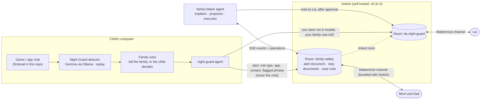

# 🌙 Night Guard Family Room

**A Night Guard alert lands in the family's group chat, and the parents and an AI agent work it out together, through [Switch](https://github.com/sandbox-quantum/switch).**

Flip the Switch hackathon, Track 02: Best Personal or Creative Workflow.

[Night Guard](https://github.com/jenniferevangelista-de/night-guard) runs on a child's computer with Gemma and spots grooming tactics in game and app chats (secrecy, photo requests, moving to a private app, threats). It already decided *what* the family is told: the risk type, the app, the contact and the flagged phrase, never the whole chat, and the child is always told when something is shared.

What it never had is the part after the alert. A parent gets a scary notification at night and has to figure out, alone, what it means and what to do. This project makes that a short conversation in the family's group chat:

1. **night-guard** posts the alert in the family room. Only what the family rules allow.
2. **family-helper** explains the risk in plain words and proposes numbered steps.
3. **A parent approves, edits or skips** each step in the thread. Nothing is written or sent before that, and only a parent can decide.
4. **family-helper carries them out**: the talk script, the evidence checklist, the report text for the app, the SaferNet / NCMEC guide when there are image requests or threats, and a calm note to the child in the child's own room. Every output is saved as a Switch room document, and a case note keeps the timeline of who decided what.

> 📺 Demo video: _link coming_ · Explainer: _link coming_

## How it looks

```
family-safety  (mom, dad, night-guard, family-helper)

night-guard     🌙 Night Guard alert · 🔴 HIGH · Roblox · contact Alex_17
                • Asked to keep a secret: "don't tell your parents ok?"
                Shared by your family rules. Lia was already told by Night Guard. The full chat stays on Lia's computer.
  ↳ family-helper  What this means: asking a child to hide a conversation from family is a well-documented
                   warning sign of grooming.
                   Here's what I suggest. I'll prepare each step only after one of you approves it:
                   1. Send Lia a calm note now: not in trouble, talk today → I'll write the note to Lia
                   2. Talk with Lia today, calmly and without punishment → I'll write the talk script
                   3. Keep the evidence before blocking → I'll write the evidence checklist
                   4. Block and report Alex_17 on Roblox → I'll write the report text for Roblox
  ↳ mom            @family-helper approve 1 3 4
  ↳ family-helper  ✅ Step 1: sent to Lia in her own room …   📄 Step 3, evidence checklist …
  ↳ dad            @family-helper edit 2: she's 10, keep it short and start by saying we love her
  ↳ family-helper  📄 Step 2, talk script …
```

A full transcript of a real run, with Gemma writing the texts, is in [docs/transcript.md](docs/transcript.md) (produced by the end-to-end check, see below).

## Architecture



### Why Switch is the center of it

Take Switch out and nothing works: there is no room, no alert, no approval and no output.

| Switch feature | Used for |
|---|---|
| Custom agents (`POST /agents`, always-on) | `night-guard` and `family-helper` are two registered Switch agents with their own keys |
| Rooms bridged to a chat app (`create_room`, bundled Mattermost) | the family room and the child's own room; parents and child use a normal chat app |
| Event stream + heartbeat (SSE, `filter=all`) | family-helper sees the alert and every parent reply in the thread |
| `send_targeted_message` | the alert addresses family-helper; the plan addresses `@mom` and `@dad` |
| `post_message` with `thread_id` | each case lives in the alert's thread |
| Room documents (`create_room_document`, `load_internal_documents`, `update_room_document`) | the alert travels as a document (structured, shared fields only); each step's output and the case note are documents |
| Linked rooms (`link_rooms`) | the family room points to the child's room |
| Addressing policy (`update_agent_detail`) | both agents answer anyone in their rooms; family-helper itself checks that the sender is a parent |

The agent protocol client is small and readable: [family_room/switch_client.py](family_room/switch_client.py).

## Run it

You need Docker (with Compose), Python 3.11+, git and openssl. About 4 GB of free RAM.

```bash
git clone https://github.com/jenniferevangelista-de/night-guard-switch
cd night-guard-switch
scripts/demo.sh
```

`scripts/demo.sh` starts Switch v0.31.0 from its published images, creates the fictional family in Mattermost (mom, dad, Lia), registers the two agents, creates the rooms, starts family-helper, and runs the end-to-end check, which plays the parents. The result is `out/transcript.md`.

To try it by hand afterwards:

```bash
python -m family_room.helper &                 # family-helper (already running if demo.sh is still up)
python -m family_room.device photo-pressure    # night-guard checks a fictional chat
```

Then open Mattermost at http://localhost:8065 as `mom` (password in `.state.json`) and answer in the alert's thread: `@family-helper approve`, `approve 1 3`, `edit 2: <your change>`, `skip 4`, `done 1`, `status`.

Fictional chats: `snap-secret`, `photo-pressure`, `meet-alone`, `gift-card-threat` (sextortion), `whatsapp-number` (the child decides, the family is not told) and `just-gaming` (nothing risky).

### Models (all free)

| Setting | Default | Options |
|---|---|---|
| `NG_DETECTOR` | `replay`: Night Guard's hand labels for these chats, so the demo needs no model | `ollama`: Gemma on the child's computer, exactly like the Night Guard app (`NG_MODEL`, default `gemma4:e4b`) |
| `NG_WRITER` | `template`: every text is a fixed template | `ollama`: Gemma on the family's own machine writes the explanation and the talk script and applies a parent's edit (`NG_WRITER_MODEL`, default `gemma3:4b`) |

With `ollama`, start Ollama and pull the model first (`ollama pull gemma3:4b`). If the model is missing or slow to answer, family-helper falls back to the templates, so a parent is never left waiting.

Safety-critical text never comes from a model: where to report, "don't pay", "you're not in trouble", what not to screenshot. That rule comes from Night Guard.

## Tests

```bash
pip install -e ".[dev]"
pytest          # 17 tests, no network: a fake Switch agent records every post and document
```

GitHub Actions runs the unit tests and, on every push, the whole thing against a real Switch v0.31.0 with Mattermost ([e2e workflow](.github/workflows/e2e.yml)). It checks that:

- the alert reaches the family room and family-helper proposes steps in its thread;
- the child is told, and nothing is written before a parent approves;
- mom's approval and dad's edit produce the documents, and Lia gets her note in her own room;
- the parts of the chat Night Guard didn't flag never reach the family room;
- when the rules say the child decides, the family room gets nothing; a harmless chat posts nothing.

The transcript of each run is uploaded as an artifact.

## What existed before, and what was built during the hackathon

| Pre-existing (Night Guard, before 04/11/2026) | Built during the hackathon (04/11 to 07/11/2026) |
|---|---|
| [`nightguard/signals.py`](nightguard/signals.py): the 13 risk signals, the kid and parent wording and their sources (verbatim) | Everything in [`family_room/`](family_room): the Switch agent protocol client, both agents, the approval workflow, the step writers, setup and the end-to-end check |
| [`nightguard/detector.py`](nightguard/detector.py): the classifier prompt, schema, evidence checks and severity (verbatim; the model call moved to `family_room/detect.py`) | `scripts/`, the GitHub Actions workflows, the tests, this README and the videos (`video/`: recorded with Playwright on a real Switch, narrated with edge-tts) |
| [`nightguard/family.py`](nightguard/family.py): the family rules (`apply_rules`, no longer writes a local file) | The Switch setup: rooms, documents, linked rooms, agent registration |
| [`video/ng/`](video/ng): the drawing helpers, narrator and audio of the Night Guard films, reused for these videos ([how](docs/VIDEOS.md)) | |
| The fictional chats in [`scenarios/chats.json`](scenarios/chats.json) come from Night Guard's evaluation set (ids noted in the file) | `whatsapp-number` app and contact names, and `just-gaming` |

Each pre-existing file says so in its header. Night Guard won Best Use of Backboard in the DEV x Hacktoberfest 2026 challenge.

## Privacy

- Every chat in this repository is fictional.
- The family room only ever receives what Night Guard's family rules share: risk type, app, contact name and the flagged phrase. The end-to-end check fails if any other part of the chat shows up there.
- The child is always told when something is shared, in their own room, in kid wording.
- Switch is self-hosted: the rooms, documents and chat history stay on the family's own server.
- Every model runs locally through Ollama: with `NG_DETECTOR=ollama` the chat is analyzed on the child's computer, and with `NG_WRITER=ollama` the texts are written on the family's own machine. No text goes to a cloud model.

## Sources

Signals and steps come from Night Guard: Public Safety Canada (2025, gaming grooming tactics), NCMEC (2026, financial sextortion; CyberTipline, Take It Down), Thorn (2022, 2025), SaferNet Brasil.

## License

MIT
